# ShiftSaathi

**Fair pay, safe work, and a voice that counts, for India's shift workers.**
PromptWars 2026 · FairShift challenge · UN SDG 8, Decent Work and Economic Growth.

**Live demo:** https://shiftsaathi-737262865993.asia-south1.run.app

Construction sites, hospitals, colleges and factories still run their workforce on paper registers and
WhatsApp groups. Workers can't see how their pay was worked out, are afraid to complain, and lose their
work history when they move on. Employers can't see who is overworked or about to quit until it is too
late. Wages are paid late, in cash, with no record. ShiftSaathi gives each side one screen built for them: a
voice-first phone app for workers in five Indian languages, and a dashboard for employers that also **pays each
worker's take-home through PhonePe**, straight from the payslip.

## Contents
[Demo video](#demo-video) · [Screenshots](#screenshots) · [Features](#features) · [Voice assistant](#voice-assistant-the-app-for-workers-who-cant-read-it) · [Tech stack](#tech-stack) · [Try it](#try-it) ·
[Run locally](#run-locally) · [Environment variables](#environment-variables) · [Architecture](#architecture) ·
[Key flows](#key-flows) · [Project structure](#project-structure) · [Error handling and validation](#error-handling-and-input-validation) ·
[Security](#security-and-privacy) · [Accessibility](#accessibility-and-low-end-phones) · [Tests](#tests) ·
[Deploy](#deploy-to-google-cloud-run) · [iPhone app](#iphone-app) · [Known limits](#known-limits)

## Demo video

[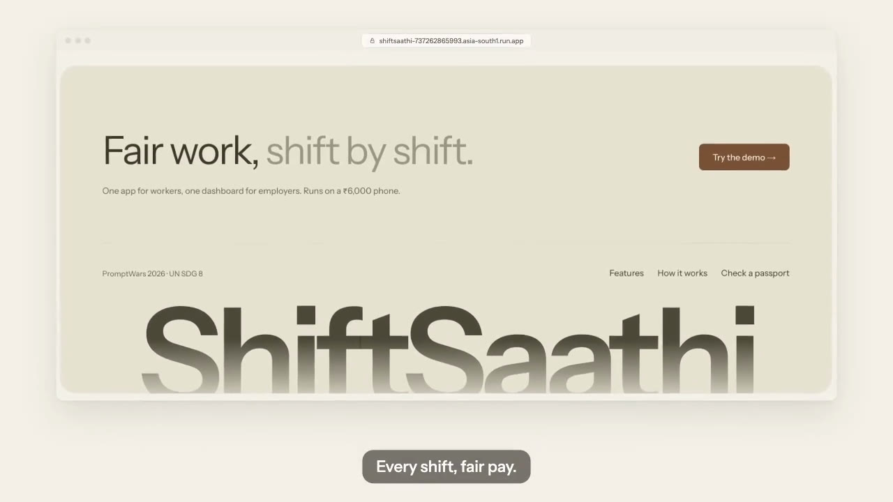](docs/video/ShiftSaathi-demo.mp4)

**▶ [Watch the 3-minute demo](docs/video/ShiftSaathi-demo.mp4)** (opens in GitHub's video player)

A 3-minute walkthrough: the problem, check-in and payslips, the voice assistant in Tamil and Hindi, safety
escalation, anonymous feedback, the Skill Passport, the employer dashboard and payroll through PhonePe. The
voice-over was generated with Gemini Live, the same model behind the app's assistant
([script and generator](docs/video/claude-design-prompt.md)).

## Screenshots

**Landing**

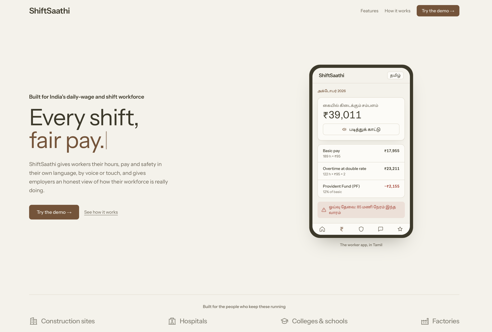

**Worker app** (phone, five languages, voice via the Talk button)

| Home: check-in and fatigue warning | Payslip explained line by line |
|---|---|
| 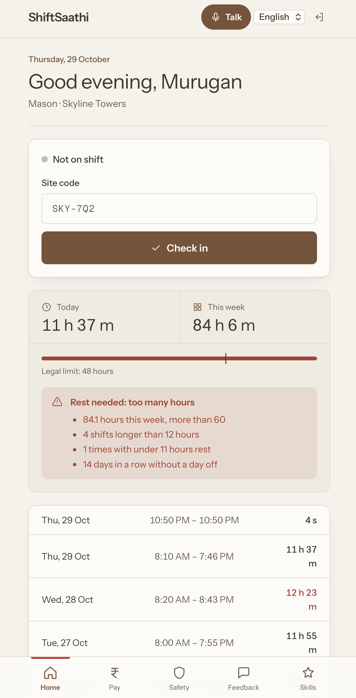 | 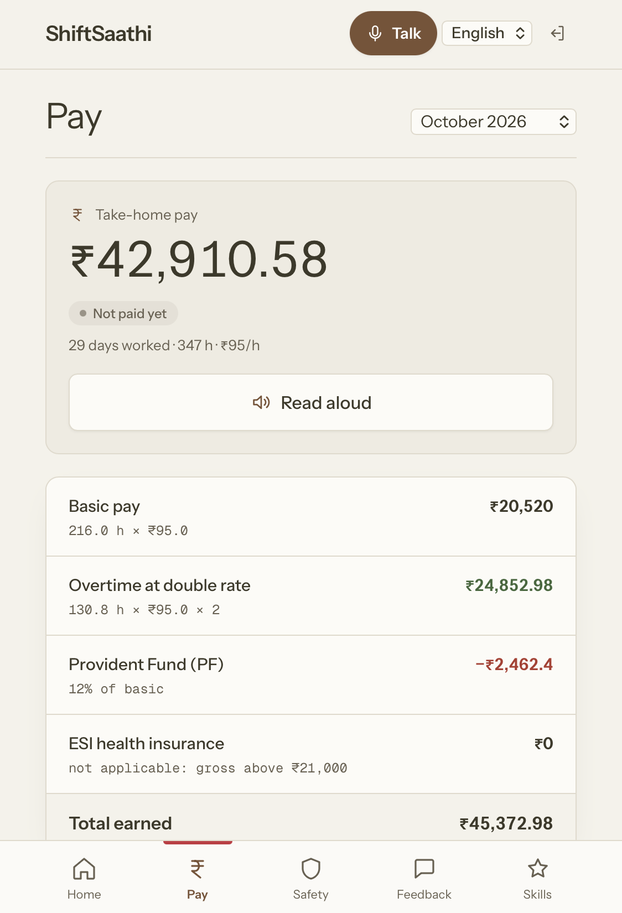 |

**Employer dashboard**

| Overview | Anonymous feedback |
|---|---|
| 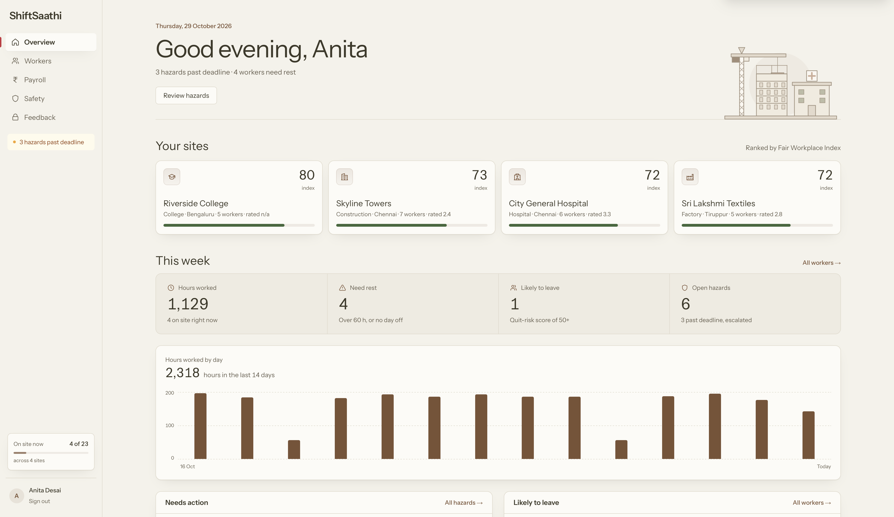 | 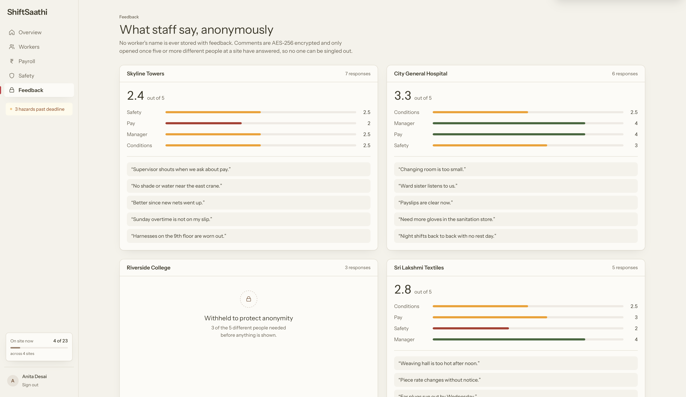 |

**Payroll through PhonePe**

| Pay wages from the payslip | PhonePe checkout for the exact take-home |
|---|---|
| 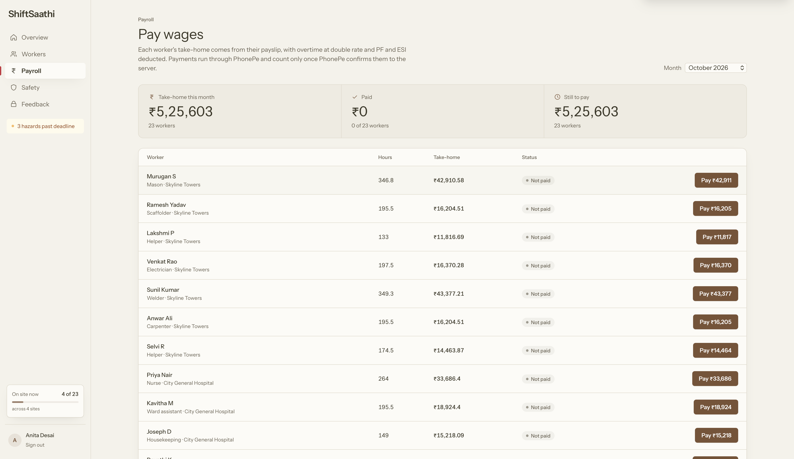 | 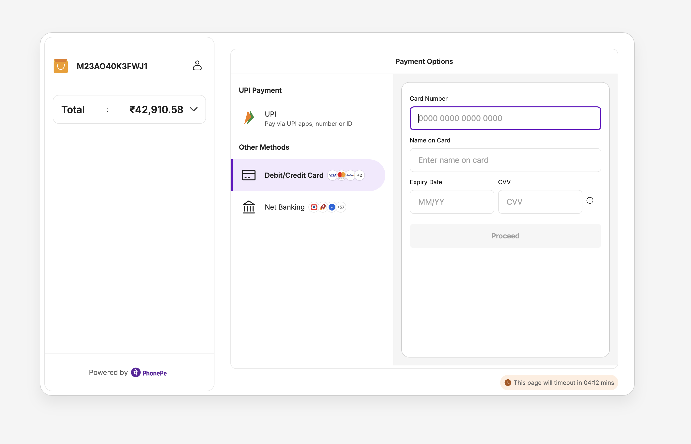 |

The amount on PhonePe's page (₹42,910.58) is the same take-home shown on Murugan's payslip and in Payroll: the server
sets it from the payslip, never the browser.

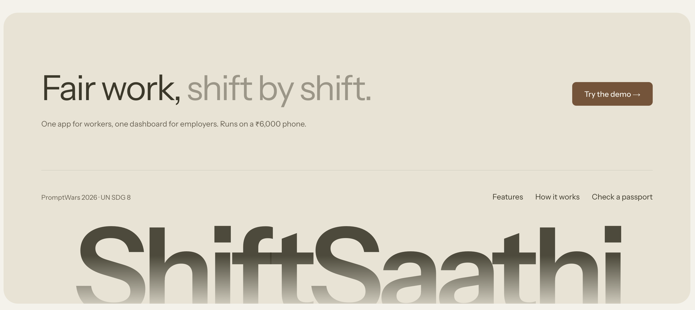

## Features

| Worker app (phone, voice first, five languages) | Employer dashboard |
|---|---|
| QR check-in with a live shift timer and overtime warning | Who is on site right now, per site |
| Payslip explained line by line, read aloud | Fair Workplace Index ranking every site |
| Payslip shows when it was paid, with the PhonePe transaction | **Payroll: pay each worker's take-home through PhonePe** |
| Hazard reports with a fix-by deadline | Hazard queue that escalates missed deadlines |
| Anonymous, encrypted feedback | Feedback shown only once 5+ different people answer |
| Skill Passport any employer can verify | Certify a worker's skill with a signature |
| Fatigue warnings past 48 / 60 hours | Fatigue and quit-risk flags with their reasons |
| **Voice assistant in Hindi, Tamil, Telugu, Kannada, English: asks about pay, hours and reports, files hazards and feedback** | Hours worked per day across all sites |

### Four sectors, one platform

The demo is seeded with one site per sector the problem statement names; the same rules apply to all.

| Sector | Demo site | What ShiftSaathi changes there |
|---|---|---|
| Construction | Skyline Towers, Chennai | Daily-wage masons see overtime past 9 h a day or 48 h a week paid at double rate (Factories Act s.51, s.54, s.59); fall hazards carry a 4-hour deadline. |
| Hospitals | City General, Chennai | Night shifts with under 11 hours' rest are flagged before fatigue causes mistakes on the ward. |
| Colleges & schools | Riverside, Bengaluru | With only three feedback responses, the site's comments stay hidden so no one can be singled out. |
| Factories | Sri Lakshmi Textiles, Tiruppur | A removed machine guard climbs to HR & Safety when the site misses its deadline. |

## Voice assistant: the app for workers who can't read it

Many shift workers read little, have never filled in a form, and are scared that a complaint can be traced back to
them. So the worker app has a **Talk** button on every screen. The worker taps it and speaks normally in **Hindi,
Tamil, Telugu, Kannada or English**. The assistant answers out loud in the same language and does the job for them.
They don't need to know which screen, which button or which category to pick.

### What a worker can do just by talking

| The worker says (in their own language) | What happens | Tool |
|---|---|---|
| "How much will I get this month?" · "Was my overtime counted?" | Reads this month's payslip at that moment: days worked, regular and overtime hours, gross and take-home, in rupees | `get_payslip` |
| "Am I working too much?" · "How many hours this week?" | Reads the last 7 days of shifts and any fatigue warning with its reasons (over 60 h, no day off, under 11 h rest) | `get_wellbeing` |
| "What happened to the problem I reported?" | Reads the status of each of their safety reports: open, in progress or resolved, who has it now, and whether it is overdue | `list_my_reports` |
| "The railing on the 9th floor is broken" | **Raises a safety concern.** Works out the category and how dangerous it is, asks only for what's missing (usually where), reads it back once and files it. It goes to the supervisor with a fix-by deadline, and is filed anonymously if the worker asks | `report_hazard` |
| "The supervisor shouts when we ask about pay" | **Gives anonymous feedback.** Works out the topic (manager, pay, safety or conditions), asks for a 1–5 rating only if none was given, reads it back and sends it. The assistant tells the worker it is anonymous, because that fear is why people stay quiet | `give_feedback` |

Check-in and check-out stay on the QR scan, so a shift can't be started without being at the site.

### Always live data, never a guess

- **Every number comes from a tool call made when the worker asks.** The assistant is told never to guess or
  remember pay, hours or report status. It calls the server, which reads the current shifts, payslip and reports,
  so the answer matches the app to the rupee, including a shift that ended a minute ago.
- **Voice uses the same code as the buttons.** The tools call the same functions in `services.py` as the REST routes.
  A hazard filed by voice gets the same deadline, escalation path and anonymity as one filed by tapping, and appears
  on the employer's dashboard straight away, marked as filed by voice.
- **Actions are confirmed on screen as well as out loud.** When a report or feedback is saved, a confirmation card
  appears in the conversation (for a report: who has it and the fix-by deadline), so the worker can see it really went through.
- **The tools are limited to the worker's own data.** The socket accepts only a signed-in worker's token, and every tool
  works on that worker only. Ratings are clamped to 1–5 and text is cut to the same limits as the forms.

### Built for people new to smartphones

- **The assistant speaks first.** It greets the worker by name and asks how it can help, so they know it is listening.
- **Language follows the screen.** The language picked in the app is the one the assistant speaks. If the worker
  starts speaking another language, it switches.
- **Short sentences, everyday words, amounts in rupees.** It never makes the worker choose a category or a severity.
- **The worker can interrupt.** Speaking over the assistant stops it straight away.
- **Captions** of both sides appear on screen, for noisy sites and for checking what was understood.
- **Safety first.** If someone is in immediate danger, it tells them to move away and call 112 before anything else.
- **If voice isn't available** (no key set, or no network), the app says so in the worker's language and every
  action stays available through the buttons.

**Example (Tamil, translated):**

> **Assistant:** Hello Murugan, how can I help with your pay, hours or safety today?<br>
> **Murugan:** The scaffolding near the east crane is shaking, someone could fall.<br>
> **Assistant:** That is dangerous. I'll report a high-risk fall hazard at the east crane scaffolding, with your name. Shall I send it?<br>
> **Murugan:** Yes, but don't put my name.<br>
> **Assistant:** Sent anonymously. The site supervisor has to fix it within 24 hours.<br>
> *Card on screen: "Report sent. Site supervisor must fix it by 30 Oct, 11:05 PM."*

## Tech stack

| Layer | Technology |
|---|---|
| Web app | Next.js 15 (static export), React 19, TypeScript (strict), Tailwind CSS |
| API | Python 3.11+, FastAPI, Pydantic v2, Uvicorn |
| Voice | Gemini Live over a WebSocket (`/ws/voice`), with tool calls into the same services as the app |
| Payments | PhonePe Standard Checkout v2 (sandbox by default) |
| Security | `cryptography` (AES-256-GCM, Ed25519, HKDF, scrypt), PyJWT |
| iPhone | Swift / SwiftUI shell with a native camera QR scanner (`ios/`) |
| Hosting | One Docker container on Google Cloud Run, secrets in Secret Manager |
| Quality | pytest (76 tests), ESLint, `tsc --noEmit`, GitHub Actions CI |

## Try it

Open the [live demo](https://shiftsaathi-737262865993.asia-south1.run.app), choose **Try the demo**, then
**Continue as a worker** (Murugan, a mason) or **Continue as an employer** (Anita, HR & Safety).

| Demo data | Value |
|---|---|
| Worker phones | `9000000001` to `9000000023` |
| PIN (every demo account) | `1234` |
| Site codes for check-in | `SKY-7Q2`, `CGH-4K9`, `RVC-2M5`, `SLT-8F3` |

## Run locally

**Prerequisites:** Python 3.11 or newer, Node.js 22 and npm, Git. Nothing else: no database and no API keys
are needed to run the app. The voice assistant and payroll payments need their keys (see below) and say so on
screen when they are missing.

```bash
git clone <this-repo-url> shiftsaathi && cd shiftsaathi
cp .env.example .env                 # every value may stay empty for a local run

# 1. Build the web app into static files
cd frontend && npm ci && npm run build && cd ..
ln -sfn ../frontend/out backend/static   # the API serves the built pages

# 2. Install and start the API
cd backend
python3 -m venv .venv && source .venv/bin/activate
pip install -r requirements-dev.txt
python -m uvicorn app.main:app --port 8080 --env-file ../.env
```

Open http://localhost:8080. API docs are at http://localhost:8080/docs outside production.
On the first start the app generates development keys into `backend/.dev-secrets.json` (git-ignored), so
sign-ins and signed passports survive a restart.

**Run the checks** (the same as CI):

```bash
cd backend && python -m pytest -q
cd frontend && npm run lint && npm run typecheck && npm run build
```

**Hot reload for the web app (optional):** set `ALLOWED_ORIGINS=http://localhost:3000` in `.env`, start the API
as above, then in `frontend/` run `NEXT_PUBLIC_API_BASE=http://localhost:8080 npm run dev`.

On Windows, use `python -m venv .venv` and `.venv\Scripts\activate`, and copy `frontend/out` to `backend/static`
instead of linking it.

## Environment variables

All variables are listed with comments in [`.env.example`](.env.example). None are needed for a local run.

| Variable | Needed for | Notes |
|---|---|---|
| `APP_ENV` | Always | `development` (default) or `production`. Production refuses to start without the three keys below. |
| `DATA_KEY` · `PASSPORT_SIGNING_KEY` · `JWT_SECRET` | Production | 32 random bytes each, base64. Generated automatically in development. |
| `ALLOWED_ORIGINS` | Split hosting | Comma-separated origins allowed by CORS, only when the web app is on another domain. |
| `GEMINI_API_KEY` | Voice | Or leave empty and set `GOOGLE_CLOUD_PROJECT` / `GOOGLE_CLOUD_LOCATION` to use Vertex AI. `LIVE_MODEL` overrides the model. |
| `PHONEPE_CLIENT_ID` · `PHONEPE_CLIENT_SECRET` · `PHONEPE_CLIENT_VERSION` | Payroll | PhonePe Standard Checkout v2 credentials. `PHONEPE_ENV=production` only on purpose. |
| `PHONEPE_WEBHOOK_USER` · `PHONEPE_WEBHOOK_PASSWORD` | Payroll | The username and password set on PhonePe's webhook. |
| `NEXT_PUBLIC_API_BASE` · `NEXT_PUBLIC_VOICE_WS_URL` | Split hosting | Read at web build time, only when the web app is hosted apart from the API. |

## Architecture

One Cloud Run container: FastAPI serves the JSON API, the `/ws/voice` socket and the exported Next.js app from
one origin. Secrets come from Secret Manager at start-up, and the voice assistant talks to Gemini Live.

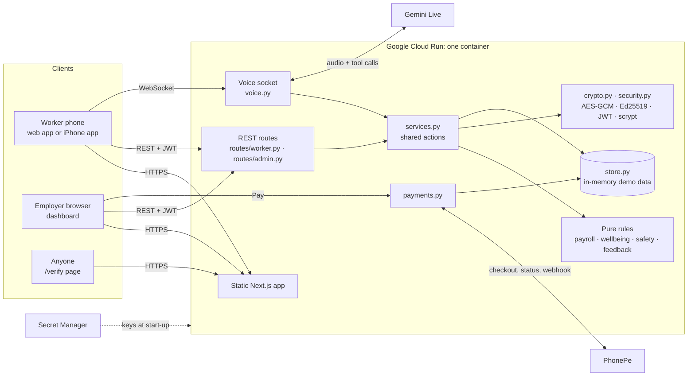

Routes stay thin: they validate the request, check the role and call `services.py`. The voice assistant calls
the same services, so every number it speaks comes from the same rules as the screen.

## Key flows

### A shift, from check-in to payslip

The worker scans the site's QR poster; the API checks the code belongs to their site and, when the phone sends a
location, that they are within the site's radius. The payslip splits hours per ISO week into regular and overtime
(past 9 h a day or 48 h a week, paid at double rate), then deducts PF and ESI, and every line can be read aloud.

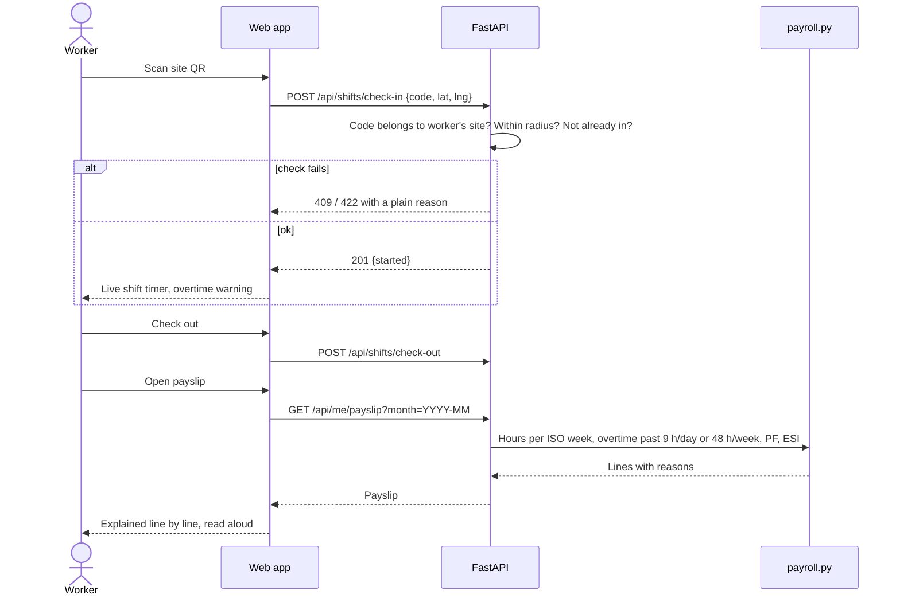

### A hazard report and its deadline

A report starts with the site supervisor. Its deadline depends on severity (critical 4 h, high 24 h, medium 72 h,
low 7 days). Missed once, it moves to the site manager; missed by twice the deadline, to HR & Safety. Reports
filed by voice follow exactly the same path.

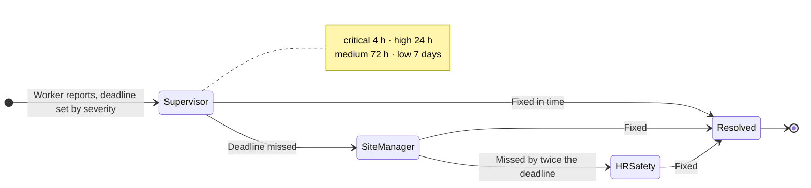

### Anonymous feedback

A rating and comment are stored with the site and ISO week only; the comment is sealed with AES-256-GCM. The
worker's voter tag goes into a separate per-site set. Until five different people have answered, the dashboard
shows a lock; after that, comments are decrypted, shuffled and shown without dates.

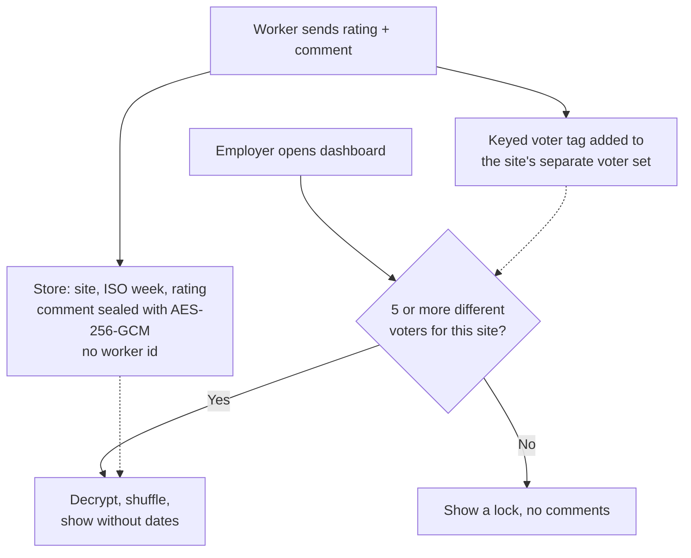

### Paying wages through PhonePe

In **Payroll** the employer picks a month and presses **Pay** next to a worker. The server works out the amount from that worker's payslip, so the browser never sets it. When PhonePe sends the
employer back, the server asks PhonePe for the order's real state rather than trusting the return link, and
accepts it only if the amount matches. PhonePe's webhook is a second confirmation, accepted only with the SHA-256 of
the username and password set on the dashboard. A month can't be paid twice, and the worker's payslip then shows the
payment date and PhonePe transaction.

To try it, create a PhonePe business test account, put its sandbox credentials in `.env` (`PHONEPE_CLIENT_ID`,
`PHONEPE_CLIENT_SECRET`, `PHONEPE_CLIENT_VERSION`), and point its webhook at `https://<your-host>/api/payments/phonepe/webhook`
with the username and password from `PHONEPE_WEBHOOK_USER` / `PHONEPE_WEBHOOK_PASSWORD`. Without them, Payroll still
shows every amount and says payments are not set up.

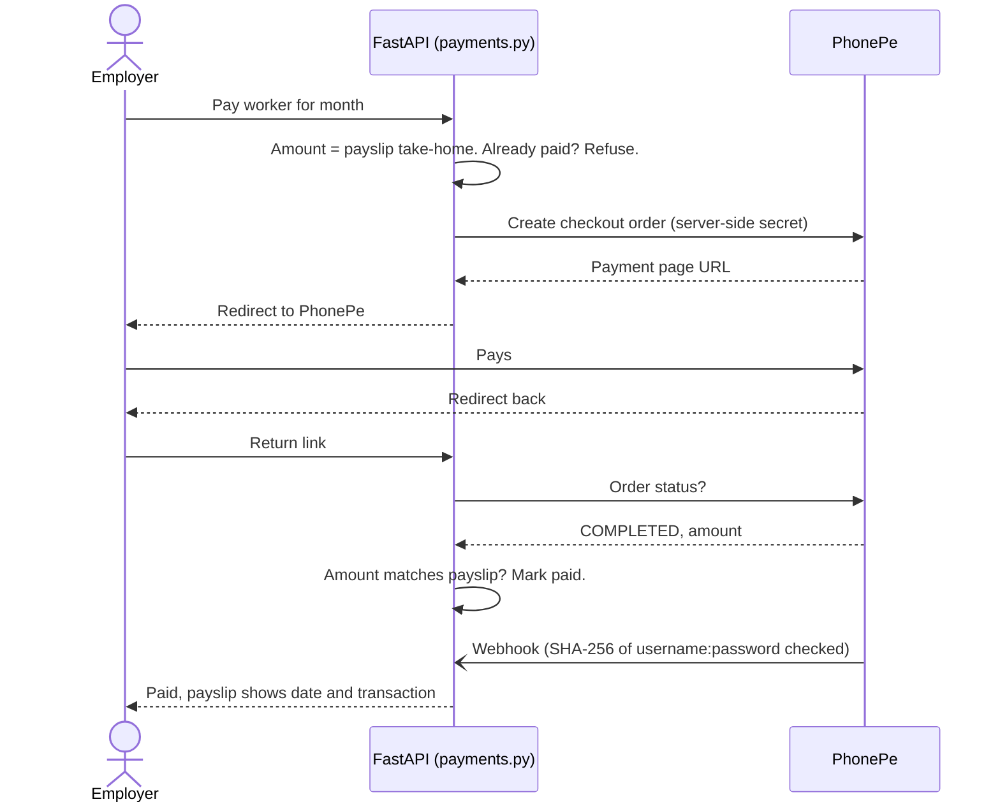

### A voice conversation

The app opens `/ws/voice` with the worker's token and the language on screen. The server starts a Gemini Live session
in that language with the worker's context and five tools. Questions become tool calls into `services.py`, so every
number is read live. Actions are saved through the same services as the buttons and confirmed on screen.

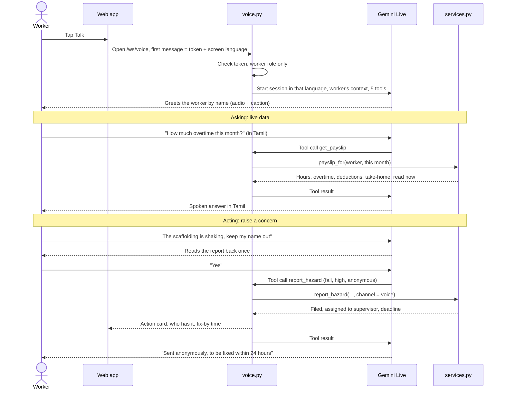

## Project structure

```
.
├── backend/
│   ├── app/
│   │   ├── main.py            App, security headers, error handler, cache rules, static web app
│   │   ├── config.py          Settings and secrets from the environment, fail-fast in production
│   │   ├── schemas.py         Request bodies, every field bounded
│   │   ├── routes/            worker.py (sign-in, shifts, pay, safety, feedback, passport) · admin.py (dashboard)
│   │   ├── services.py        Actions shared by the REST routes and the voice assistant
│   │   ├── payroll.py · wellbeing.py · safety.py · feedback.py   The rules, each a small pure module
│   │   ├── crypto.py · security.py   Encryption, signing, sign-in
│   │   ├── voice.py           Gemini Live bridge with five tools
│   │   ├── payments.py        PhonePe payments, status checks and webhook
│   │   └── store.py           In-memory data and the demo seed
│   └── tests/                 pytest suite
├── frontend/
│   ├── app/                   Pages: landing, login, worker, admin, verify
│   ├── components/            Shared UI kit and the two apps' sections
│   └── lib/                   API client, translations, voice, live polling
├── ios/                       iPhone app: native shell with a camera QR scanner
├── docs/screenshots/          Images used in this README
├── docs/video/                Demo film: Claude Design prompt, voice-over script and generator
├── Dockerfile                 One container: builds the web app, runs the API
├── .env.example               Every environment variable, without values
└── .github/workflows/ci.yml   Tests, lint, type check and build on every push
```

## Error handling and input validation

- **Every request body is a typed Pydantic model** (`schemas.py`) with bounds on every field: phone is 10 digits,
  PIN 4 digits, text has length limits, ratings 1 to 5, months `YYYY-MM`, categories and languages from fixed
  lists. Bad input is refused with a `422` before any route code runs.
- **Expected failures return a clear status and a plain message** the app shows as is: wrong PIN (`401`), too many
  tries (`429`), wrong role (`403`), wrong site or too far away (`422`), already checked in or already paid
  (`409`), unknown record (`404`), PhonePe unreachable (`502`), payments not set up (`503`).
- **Unexpected errors** are caught by one handler in `main.py`: the full trace goes to the server log, the client
  gets a `500` with a generic message and no internal detail (tested in `test_api.py`).
- **Configuration errors stop the server at start-up** rather than at the first request: a missing or wrong-length
  key in production raises with the variable's name.
- **The web app** shows the server's message on failure, signs the user out on `401`, and keeps working
  without voice or payments when those aren't configured.

## How it meets the judging criteria

| Criterion | Where to look |
|---|---|
| **Problem alignment** | Every item in the brief is built: shift tracking (`services.check_in`), clear payslips (`payroll.py`), safety reporting (`safety.py`), honest feedback (`feedback.py`), Skill Passport (`crypto.PassportSigner`), fatigue alerts (`wellbeing.fatigue`), admin dashboard (`routes/admin.py`), voice in local languages (`voice.py`), plus wage payment through PhonePe (`payments.py`) and an iPhone app (`ios/`). Two interfaces, four sectors. |
| **Code quality** | Each rule is a small pure function with its reasons returned; routes stay thin and call `services.py`; one shared UI kit (`components/ui.tsx`); typed request bodies (`schemas.py`) and typed responses (`lib/api.ts`); ESLint and TypeScript `strict` with no unused code. |
| **Security** | No secrets in the repo, Secret Manager at runtime, a fail-fast start in production, scrypt PINs with lockout, JWT with role checks, bounded inputs, AES-256-GCM, Ed25519, HMAC reporter tags, CSP and HSTS. See [Security](#security-and-privacy). |
| **Efficiency** | One container and one origin; the web app is static files; about 130 KB of JavaScript for the worker app; fonts load per script; hashed assets cached for a year; pages poll every 15 s only while visible. |
| **Testing** | 76 pytest tests: labour rules, encryption and signatures, every API flow and role check, error handling, the voice tools, translation completeness and colour contrast. CI runs them, plus ESLint (Next.js rules), a strict type check and a production build, on every push. |
| **Accessibility** | WCAG AA contrast enforced by a test, 48 px touch targets, a skip link, visible focus, labelled controls, `lang` set per language, `prefers-reduced-motion` respected, read-aloud and pictures for low literacy. |

## Security and privacy

- **Feedback is anonymous by construction.** Feedback records hold no worker id, only the ISO week. Comments
  are sealed with **AES-256-GCM**, with the site id bound in as associated data, and a site's comments are
  only decrypted once 5 or more *different* people have answered. People are counted with a keyed voter tag
  stored apart from the answers, so one worker sending five replies cannot unlock them alone.
- **Anonymous hazard reports** carry an HMAC-SHA256 reporter tag (key derived with HKDF), so the reporter
  can follow their own report while no screen shows who sent it. Anonymous reports never feed the
  manager-visible quit-risk score.
- **Skill Passports** are signed with **Ed25519**. A new employer verifies one at `/verify` without an
  account; changing one character breaks the signature. The credential travels in the URL fragment, which
  browsers never send to server logs.
- **Payments can't be faked or inflated.** PhonePe payments are created server-side from the payslip amount, and
  a payment only counts once PhonePe itself confirms it, through the status API or an authenticated webhook. The
  client secret never leaves the server, and the server uses PhonePe's sandbox unless production is set on purpose.
- **No keys in the code.** `.env` files are git-ignored and docker-ignored; only `.env.example` without values is
  committed. On Cloud Run the keys come from Secret Manager and the server refuses to start in production without them.
- Phone + 4-digit PIN sign-in, PINs hashed with scrypt, 5 wrong tries lock the number for 5 minutes,
  12-hour JWTs, role checks on every route, bounded input on every field, the voice token sent in the first
  message rather than the URL, and strict headers (CSP, HSTS, `frame-ancestors 'none'`, `nosniff`).

## Accessibility and low-end phones

- Every text colour meets WCAG AA contrast (4.5:1), checked by `tests/test_web_assets.py`; touch targets are
  48 px or larger; there is a skip link; keyboard focus is always visible; motion stops under
  `prefers-reduced-motion`.
- The whole worker interface is in English, हिन्दी, தமிழ், తెలుగు and ಕನ್ನಡ; pictures and faces carry meaning
  for workers who read little; payslips can be read aloud with the phone's own speech engine; the voice
  assistant answers in the language on screen.
- The worker app loads in about 130 KB of JavaScript and installs as a web app.

## Tests

```bash
cd backend && python -m pytest -q      # 76 tests
```

| File | Covers |
|---|---|
| `test_rules.py` | Overtime (daily vs weekly), PF and ESI, fatigue rules, quit risk, escalation, the Fair Workplace Index |
| `test_privacy.py` | AES-256-GCM tamper and wrong-key failures, the 5-people threshold, Ed25519 forgery, reporter tags |
| `test_api.py` | Sign-in and lockout, role checks, check-in geofence, anonymous reports, encrypted storage, one worker unable to unlock feedback, passports, headers, the 500 handler |
| `test_payments.py` | Amount taken from the payslip, status checked with PhonePe, wrong amount refused, webhook authentication, no double payment, managers only |
| `test_voice.py` | Session language, greeting, payslip and hazard tools, feedback clamping, unknown tools |
| `test_web_assets.py` | Every language has every string and placeholder; every text colour passes WCAG AA |

## Deploy to Google Cloud Run

The `Dockerfile` builds the web app and the API into one image; Cloud Run builds it from source.

```bash
PROJECT=your-project-id
gcloud config set project $PROJECT
gcloud services enable run.googleapis.com cloudbuild.googleapis.com artifactregistry.googleapis.com \
  secretmanager.googleapis.com

# three random 32-byte app secrets, and the Gemini key (typed in, never saved to a file)
for s in data-key passport-signing-key jwt-secret; do
  python3 -c "import os,base64;print(base64.b64encode(os.urandom(32)).decode(),end='')" |
    gcloud secrets create shiftsaathi-$s --data-file=-
done
read -rs GEMINI && printf %s "$GEMINI" | gcloud secrets create shiftsaathi-gemini-key --data-file=- && unset GEMINI

# let the service read them
SA=$(gcloud projects describe $PROJECT --format='value(projectNumber)')-compute@developer.gserviceaccount.com
gcloud projects add-iam-policy-binding $PROJECT --member=serviceAccount:$SA --role=roles/secretmanager.secretAccessor

gcloud run deploy shiftsaathi --source . --region asia-south1 --allow-unauthenticated \
  --max-instances 1 --timeout 3600 --session-affinity \
  --set-secrets DATA_KEY=shiftsaathi-data-key:latest,PASSPORT_SIGNING_KEY=shiftsaathi-passport-signing-key:latest,JWT_SECRET=shiftsaathi-jwt-secret:latest,GEMINI_API_KEY=shiftsaathi-gemini-key:latest
```

`--max-instances 1` because demo data lives in memory (see `store.py`); `--timeout 3600` keeps voice calls
open. To run voice on Vertex AI with no key at all, drop the Gemini secret, set
`GOOGLE_CLOUD_PROJECT=$PROJECT`, and grant the service account `roles/aiplatform.user`. The health check is `GET /health`.

## iPhone app

`ios/` is a native shell around the live worker app: it opens straight on the worker sign-in, scans the site QR
with the iPhone camera (Safari's web view has no barcode reader), and lets the voice assistant use the microphone.
Because the page itself comes from Cloud Run, the app always shows the latest release.

```bash
cd ios && xcodegen          # regenerates ShiftSaathi.xcodeproj from project.yml
open ShiftSaathi.xcodeproj  # pick your team under Signing & Capabilities, then Run on your iPhone
```

## Known limits

- Data is in memory and resets to the demo seed on restart; production would move `store.py` to Firestore.
- A week that straddles two months is judged only on its days inside the payslip's month.
- Live updates poll every 15 s rather than being pushed.
- Payroll uses PhonePe Standard Checkout in sandbox, so wages are collected into the merchant account; sending
  them on to each worker's bank or UPI needs PhonePe's payouts product.
- The CSP allows inline scripts, which Next.js's static export needs for hydration; a nonce-based policy
  would need server rendering.
